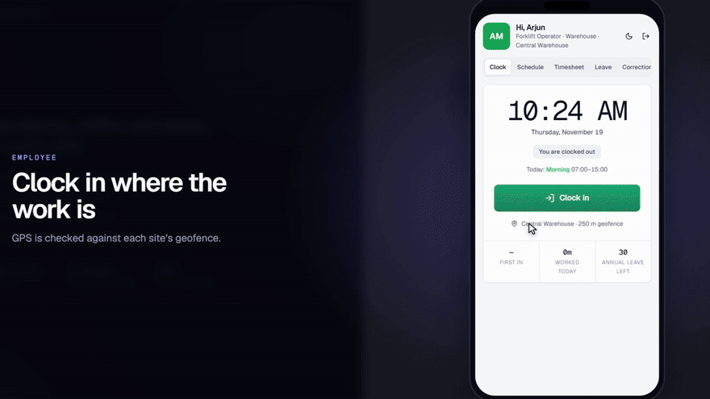
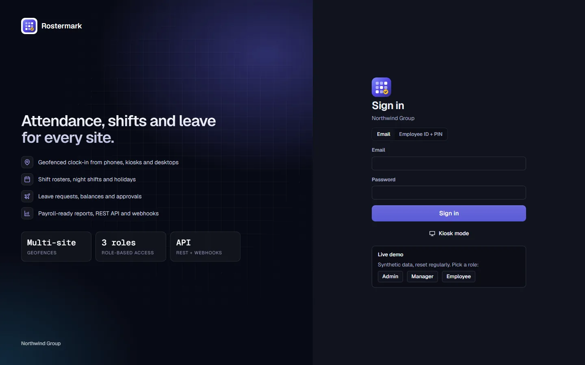
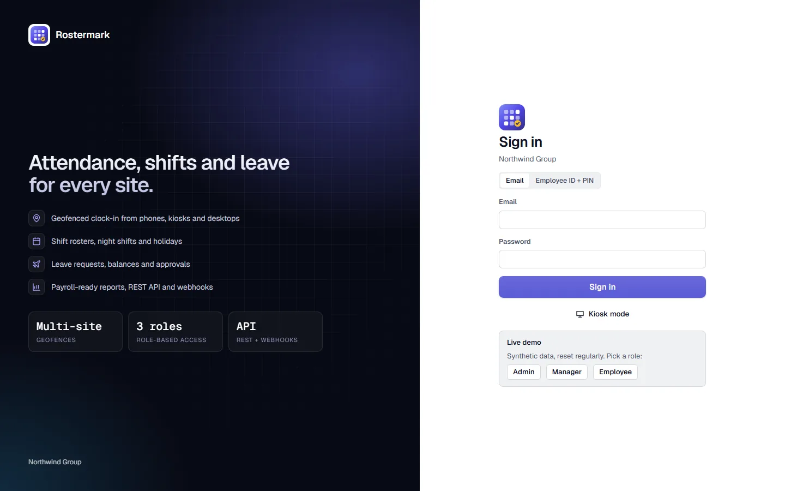
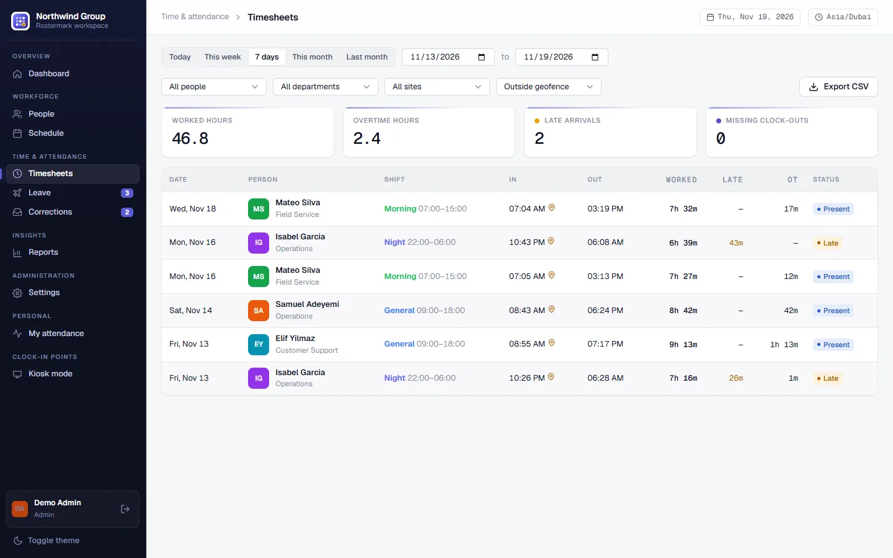
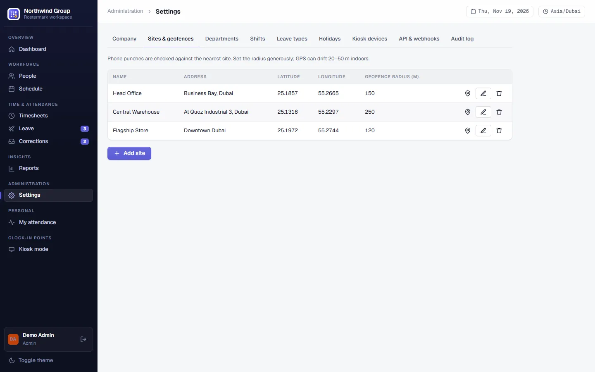
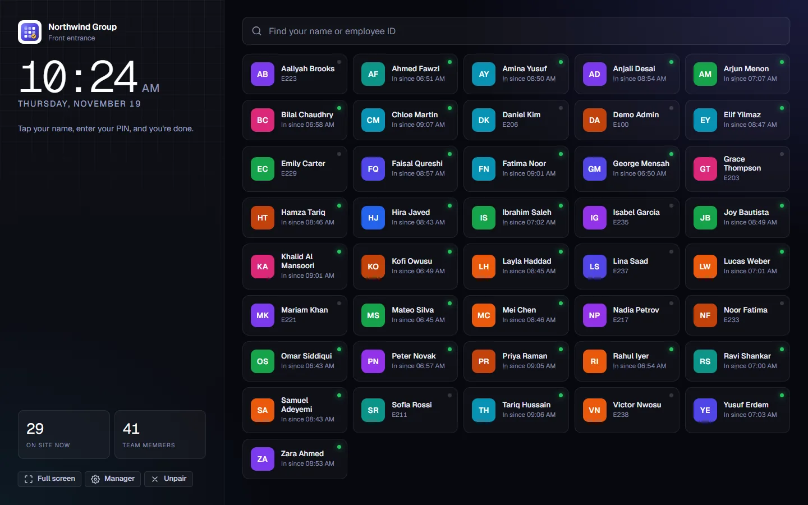
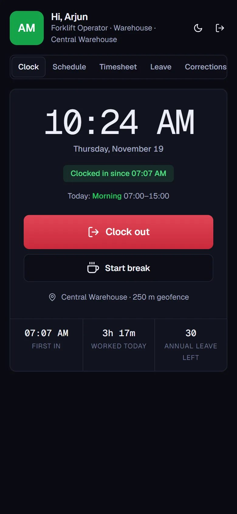

# Rostermark

**Self-hosted time and attendance, shift rostering and leave management for multi-site teams.** Staff clock in from their phones inside a geofence, at a paired kiosk, or from the Rostermark desktop app. Managers plan the weekly roster, approve leave and time corrections, and pull payroll-ready reports. Integrations use a REST API and signed webhooks.

[Try the live demo](https://rostermark.92.4.64.89.sslip.io) · [Download the desktop app](https://github.com/MusaBukhari237/rostermark/releases/latest) · [Report an issue](https://github.com/MusaBukhari237/rostermark/issues)

### ▶ Watch the walkthrough (3:32)

[](https://github.com/MusaBukhari237/rostermark/releases/download/demo-video/rostermark-walkthrough.mp4)

*Click the preview to play the full narrated walkthrough (MP4, 1080p). It's also attached to the [demo-video release](https://github.com/MusaBukhari237/rostermark/releases/tag/demo-video).*

> The sign-in page has one-click demo logins for **Admin**, **Manager** and **Employee**. The data is synthetic and resets every few hours.

## Who it's for

Growing businesses with several sites, shifts or departments: retail chains, warehouses and logistics, facility management, field service, security, healthcare, hospitality and multi-branch offices. It works for 20 people and comfortably handles a few hundred.

## Features

### Clock in anywhere, honestly
- **Geofenced phone clock-in**: each site has a GPS radius. Punches outside it are blocked, or flagged if you prefer, with the distance recorded.
- **Paired kiosks**: every kiosk device has its own key and site, can be revoked on its own, and shows a last-seen time.
- **Desktop app** for Windows: a dashboard window plus a locked full-screen kiosk mode (Ctrl+K, exit with Ctrl+Shift+Q).
- **Optional selfie** on clock-in/out, and per-punch source (`mobile`, `kiosk`, `desktop`, `api`, `manual`).

### Plan and track
- **Shifts** with grace periods, unpaid breaks and working days. **Night shifts** (e.g. 22:00–06:00) stay on one work day.
- **Weekly roster planner**: click a cell to swap a shift or give a day off, set a whole week at once, or copy last week.
- **Live dashboard**: on site now, late arrivals, people still to arrive, on leave, a per-site headcount, and alerts for pending approvals, missing clock-outs and out-of-fence punches.
- **Timesheets**: filter by person, department, site and status. Edit punches with a full audit trail.

### Leave and approvals
- **Leave types** with yearly quotas, plus paid and unpaid leave. Employees see their balances and request leave from their phone.
- **Approvals**: approve or reject with a note. Approved leave appears on the roster and stops absences being counted.
- **Time corrections**: an employee asks for a missed punch, and approving it writes the punch into the timesheet.
- **Holidays** shared across the organisation.

### Reports and integrations
- Attendance rate, punctuality, hours, overtime, absences and leave, plus a **department × weekday heatmap** and a status mix.
- **CSV exports**: summary, detailed timesheet and a **payroll export** (regular vs. overtime hours, paid leave, unpaid absences).
- **REST API** with read and read-write keys, and **webhooks** with HMAC-SHA256 signatures.
- **Roles**: admin, manager and employee. Logins use email + password or employee ID + PIN.
- **White-label**: logo, accent colour, company name and product name.

## Screenshots

Built for data-dense, multi-site work: Geist and Geist Mono type, a dark grouped sidebar, compact tables, and a dark glass kiosk.

| | |
|---|---|
| <br>**Sign-in (light)** | <br>**Sign-in (dark)** |
| <br>**Multi-site dashboard** | <br>**Dashboard in dark mode** |
| <br>**Weekly roster** | <br>**Timesheets filtered to punches outside a geofence** |
| <br>**Leave approvals** | <br>**Reports and heatmap** |
| <br>**Sites and geofences** | <br>**Paired kiosk** |
| <br>**Employee phone, geofenced clock-in** | |

## Quick start

```bash
git clone https://github.com/MusaBukhari237/rostermark.git
cd rostermark
docker compose up -d          # http://localhost:3000
```

Or run it with Node.js 22.13 or later. There are no npm dependencies.

```bash
npm start                 # guided setup on first visit
DEMO=1 npm start          # sample organisation with 40 people, 3 sites and 4 shifts
npm test
```

Then, in **Settings**:

1. **Sites & geofences**: add each location. Use *Use my current location* while standing on site.
2. **Shifts**, **Departments**, **Leave types** and **Holidays**.
3. **People**: add people or import a CSV, and set each person's department, home site, default shift, PIN and/or password.
4. **Kiosk devices**: *Use this browser as the kiosk*, or create a pairing key for a tablet.

## Desktop app

`desktop/` holds an Electron shell. Download the portable `.exe` from [Releases](https://github.com/MusaBukhari237/rostermark/releases/latest) and enter your server address on first launch. To pre-configure a build, set `defaultServer` in `desktop/config.json`.

```bash
cd desktop && npm install && npm run dist
```

## REST API

Create a key in **Settings → API & webhooks**, then:

```bash
curl -H "Authorization: Bearer rk_..." "https://your-server/api/v1/attendance?from=2026-11-01&to=2026-11-30"
curl -H "Authorization: Bearer rk_..." https://your-server/api/v1/employees
curl -H "Authorization: Bearer rk_..." "https://your-server/api/v1/punches?since=1767225600000"
curl -X POST -H "Authorization: Bearer rk_..." -H "Content-Type: application/json" \
     -d '{"code":"E204","type":"in","device":"Gate reader 2"}' https://your-server/api/v1/punches   # write keys only
```

**Webhooks** send `POST` requests with a JSON body `{ event, at, data }` for `punch.created`, `leave.requested`, `leave.decided` and `correction.requested`. To verify one, compute `sha256=HMAC_SHA256(rawBody, secret)` and compare it with the `X-Rostermark-Signature` header.

## Configuration

| Variable | Default | Purpose |
|---|---|---|
| `PORT` | `3000` | HTTP port |
| `DATA_DIR` | `./data` | SQLite database and session key. Back this up. |
| `ADMIN_EMAIL`, `ADMIN_PASSWORD` | – | Creates the first admin on an empty database |
| `SESSION_SECRET` | random, saved in `DATA_DIR` | Signs session cookies |
| `DEMO`, `DEMO_RESET_HOURS` | off, `0` | Sample data, and how often to reset it |
| `DEMO_PROFILE` | – | `construction` relabels the sample data for contracting, fit-out and workshop teams |
| `BRAND_DIR`, `APP_NAME` | `./brand`, `Rostermark` | White-label settings (`brand.json` + logo) |

Run Rostermark behind HTTPS. Browsers block location and camera access on plain HTTP.

## How attendance is calculated

Each person's day uses a roster override if there is one, otherwise their default shift on its working days. Approved leave and holidays override absences. **Late** means the first clock-in came after the shift start plus grace. **Early leave** means the last clock-out came before the shift end. **Overtime** is worked time beyond the shift length minus its unpaid break, after an optional threshold. Punches before the day cut-off (default 04:00), and any clock-out that closes an open clock-in from the previous evening, belong to the previous work day.

## Tech

Node.js 22 with built-in SQLite (`node:sqlite`), no framework, no npm runtime dependencies, and a Preact + htm UI with no build step. Passwords and PINs use scrypt; API keys and kiosk keys are stored as SHA-256 hashes. Every manager action is written to an audit log.

## Related projects

- **[Punchwell](https://github.com/MusaBukhari237/punchwell)**: the simplest kiosk and phone time clock.
- **[Musterdesk](https://github.com/MusaBukhari237/musterdesk)**: supervisors mark crews in bulk, offline.

## Sponsors

Supported by [LeadCeleris](https://www.leadceleris.com/) and [AIFFICIENTO](https://www.aifficiento.biz/).

## Contributing

Read [CONTRIBUTING.md](CONTRIBUTING.md) and [SECURITY.md](SECURITY.md). Released under the [MIT license](LICENSE).

<sub>Keywords: time and attendance system, shift scheduling software, employee roster, leave management, geofencing time clock, GPS attendance app, workforce management, open source HR, self-hosted attendance, kiosk time clock, payroll export, REST API.</sub>
